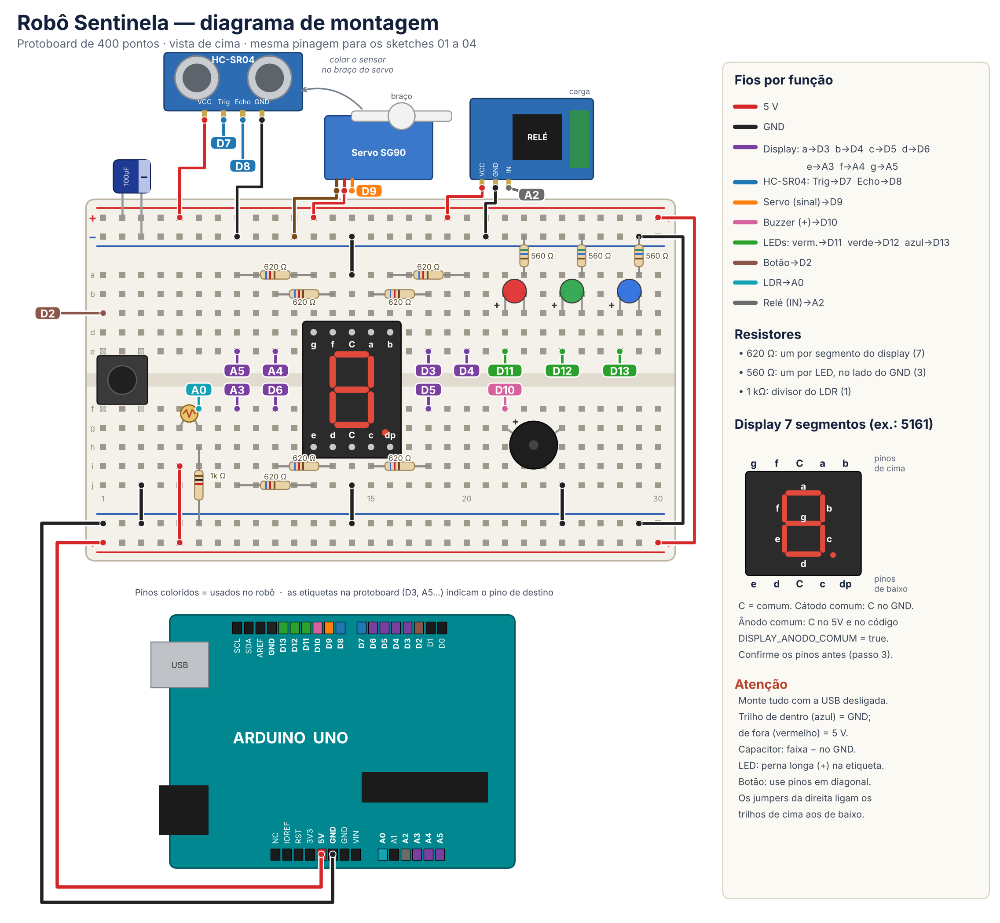
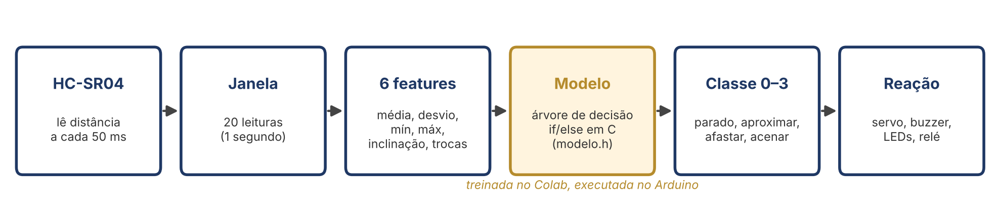

# Minicurso de Robótica — Robô Sentinela com Machine Learning

Minicurso prático de **4 horas** para os primeiros períodos de **Engenharia de Computação**.
Os alunos montam, peça por peça, um robô sentinela com Arduino. Depois treinam em Python um modelo de *Machine Learning* que reconhece gestos e o embarcam no próprio Arduino (TinyML).



## O que o robô faz

Uma "cabeça" com sensor ultrassônico, montada sobre um servo motor, patrulha o ambiente. Quando alguém se aproxima, ela para e reconhece o gesto feito com a mão:

| Gesto | Classe | Reação |
|---|---|---|
| Mão parada / ninguém | 0 · PARADO | Continua vigiando |
| Mão se aproximando | 1 · APROXIMAR | Alarme: sirene + relé |
| Mão se afastando | 2 · AFASTAR | "Tchau" e volta a patrulhar |
| Aceno (vai-e-vem) | 3 · ACENAR | Cumprimenta: balança a cabeça + melodia |

Ninguém escreve as regras dos gestos à mão. Uma **árvore de decisão** aprende essas regras a partir de gestos gravados pelos próprios alunos e é convertida automaticamente em código C (`modelo.h`).



## Estrutura do curso

| Horário | Parte | Conteúdo | Pasta |
|---|---|---|---|
| 0:00–1:40 | **Parte 1** | Arduino passo a passo: cada componente montado no lugar definitivo e testado | [`parte1-arduino-passo-a-passo`](parte1-arduino-passo-a-passo) |
| 1:40–1:50 | — | Intervalo | |
| 1:50–2:20 | Parte 2 · Bloco 2 | Comportamento por regras: `millis()` e máquina de estados | [`parte2-robo-sentinela`](parte2-robo-sentinela) |
| 2:20–3:15 | Parte 2 · Bloco 3 | Machine Learning: coleta, treino no Colab, avaliação | [`parte2-robo-sentinela/ml`](parte2-robo-sentinela/ml) |
| 3:15–3:50 | Parte 2 · Bloco 4 | Integração do modelo no robô | [`parte2-robo-sentinela`](parte2-robo-sentinela) |
| 3:50–4:00 | Encerramento | Teste cruzado entre grupos | |

## Organização do repositório

```
minicurso-robo-sentinela/
├── parte1-arduino-passo-a-passo/   10 códigos de teste, um por componente
├── parte2-robo-sentinela/
│   ├── 01_teste_hardware/          testa o robô inteiro
│   ├── 02_sentinela_regras/        robô por regras (máquina de estados)
│   ├── 03_coleta_dados/            grava gestos rotulados em CSV
│   ├── 04_sentinela_ml/            robô final com o modelo embarcado
│   └── ml/                         notebook do Colab + dados de exemplo
├── docs/
│   ├── apostila/                   roteiro do professor + apostila do aluno (.docx e .pdf)
│   ├── diagramas/                  montagem completa, etapas, Arduino, protoboard
│   └── slides/                     apresentações (PDF)
└── ferramentas/                    scripts que geraram os diagramas e a apostila
```

## Material por grupo

| Item | Qtd. |
|---|---|
| Arduino Uno (ou compatível) + cabo USB | 1 |
| Protoboard 400 pontos | 1 |
| Sensor ultrassônico HC-SR04 | 1 |
| Micro servo SG90 | 1 |
| Display de 7 segmentos, 1 dígito | 1 |
| LEDs vermelho, verde e azul | 1 de cada |
| Buzzer 5 V, push button, LDR, módulo relé 5 V | 1 de cada |
| Resistores 620 Ω / 560 Ω / 1 kΩ | 7 / 3 / 1 |
| Capacitor eletrolítico 100 µF | 1 |
| Jumpers macho-macho | ~25 |
| Jumpers macho-fêmea (para o HC-SR04) | 4 |
| Fita dupla face e uma base para o servo | — |

## Pinagem (igual para todos os códigos)

| Componente | Pino | Componente | Pino |
|---|---|---|---|
| Botão | D2 | Buzzer | D10 |
| Display a, b, c, d | D3, D4, D5, D6 | LED vermelho / verde / azul | D11 / D12 / D13 |
| Display e, f, g | A3, A4, A5 | LDR (divisor com 1 kΩ) | A0 |
| HC-SR04 Trig / Echo | D7 / D8 | Relé (IN) | A2 |
| Servo (sinal) | D9 | Capacitor 100 µF | entre 5 V e GND |

LEDs com resistor de 560 Ω e segmentos do display com 620 Ω. Diagrama completo: [`docs/diagramas/montagem_completa.png`](docs/diagramas/montagem_completa.png).

## Como usar

1. Instale a [Arduino IDE 2](https://www.arduino.cc/en/software). Placas compatíveis podem precisar do driver CH340.
2. Abra cada código pela pasta dele. A IDE exige que o `.ino` fique numa pasta com o mesmo nome.
3. No topo dos códigos há três ajustes que dependem do seu kit. Descubra os valores certos com o `01_teste_hardware`:
   ```cpp
   const bool DISPLAY_ANODO_COMUM = false; // true se o comum do display vai no 5 V
   const bool BUZZER_ATIVO        = false; // true se o buzzer apita sozinho com 5 V
   const bool RELE_ATIVO_BAIXO    = true;  // a maioria dos módulos liga com LOW
   ```
4. Para o ML, abra `parte2-robo-sentinela/ml/treino_modelo_colab.ipynb` no [Google Colab](https://colab.research.google.com). Envie o CSV gravado com o `03_coleta_dados` e coloque o `modelo.h` gerado na pasta `04_sentinela_ml`.

> O `modelo.h` que vem no repositório foi treinado com **dados simulados**. Ele serve só para o código compilar. Substitua pelo modelo treinado com os seus gestos.

## Autor

Prof. Paulo César da Silva Junior
