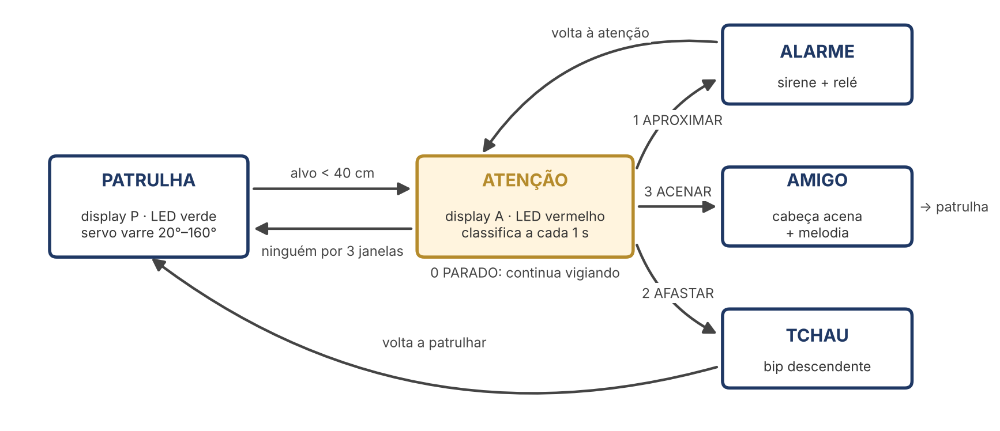

# Parte 2 — Robô Sentinela com Machine Learning

Pré-requisito: a montagem da Parte 1 concluída e aprovada no `01_teste_hardware`.

| Código | Bloco | O que faz |
|---|---|---|
| [`01_teste_hardware`](01_teste_hardware) | fim da Parte 1 | Testa LEDs, display, buzzer, servo e relé em sequência. Depois mostra distância, luz e botão no Serial Plotter. |
| [`02_sentinela_regras`](02_sentinela_regras) | Bloco 2 | Robô por regras: máquina de estados PATRULHA → ATENÇÃO → ALARME, com `millis()` em vez de `delay()`. |
| [`03_coleta_dados`](03_coleta_dados) | Bloco 3 | Grava gestos rotulados. Cada aperto do botão gera uma janela de 20 leituras (1 s), resumida em 6 *features*, e imprime uma linha de CSV. |
| [`ml/treino_modelo_colab.ipynb`](ml/treino_modelo_colab.ipynb) | Bloco 3 | Carrega o CSV, explora os dados, treina a árvore de decisão, mostra a matriz de confusão e o overfitting, e exporta o `modelo.h`. |
| [`04_sentinela_ml`](04_sentinela_ml) | Bloco 4 | Robô final: patrulha e, na ATENÇÃO, classifica o gesto a cada segundo com o modelo embarcado. |

## As 6 features

| Feature | O que mede |
|---|---|
| `media` | Distância média na janela (cm) |
| `desvio` | Desvio padrão: quanto a mão se moveu |
| `minimo`, `maximo` | Alcance do gesto |
| `inclinacao` | Tendência da reta por mínimos quadrados (cm/s); negativa = aproximando |
| `trocas` | Quantas vezes a mão inverteu o sentido (zona morta de ±2 cm) |

A função `calcularFeatures()` é **idêntica** no `03_coleta_dados` e no `04_sentinela_ml`. Se o robô calcular as features de outro jeito, o modelo recebe números que nunca viu e erra.

## Fluxo de trabalho do ML

1. Carregue o `03_coleta_dados` e grave cerca de 20 gestos por classe. Varie a pessoa, a velocidade e a distância.
2. Copie todo o Serial Monitor e salve como `dados_grupoX.csv`. As linhas com `#` são ignoradas.
3. Rode o notebook no Colab e baixe o `modelo.h`.
4. Substitua o `04_sentinela_ml/modelo.h` e carregue o `04_sentinela_ml`.
5. O robô erra um gesto com frequência? Grave mais exemplos dessa classe e retreine.

O arquivo `ml/dados_exemplo_simulado.csv` tem dados **simulados**. Use-o só para testar o notebook sem hardware.
